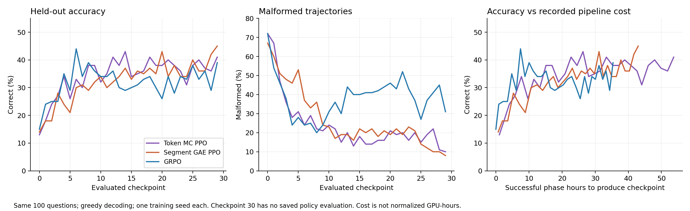

# Token MC PPO, segment GAE PPO, and GRPO

**Segment GAE PPO is my current practical choice for late-stage accuracy and reliability. Token MC PPO has the highest average accuracy over the learning curve but is substantially more expensive. GRPO learns fastest early and is cheapest. These runs do not establish a statistically decisive final-checkpoint winner.** Neither critic method, as currently demonstrated, is sufficient by itself for a strong algorithmic paper; both can support a stronger study of credit assignment under context compaction.

This report reads the three named runs, current estimator implementations, saved critic manifests, and related primary research. No model was retrained or re-evaluated. All 30 saved evaluations per run use the same 100 questions and greedy decoding. All methods completed 30 updates, but the last saved policy evaluation is checkpoint 29. Critic diagnostics labeled update 30 evaluate trajectories generated by checkpoint 29.

| Measurement | Token MC PPO | Segment GAE PPO | GRPO |
|---|---:|---:|---:|
| Initial accuracy | 13% | 14% | 15% |
| Mean accuracy, checkpoints 1–10 | 30.0% | 26.5% | **32.5%** |
| Mean accuracy, checkpoints 1–29 | **35.03%** | 32.97% | 32.48% |
| Mean accuracy, checkpoints 20–29 | 37.5% | **38.2%** | 33.0% |
| Latest accuracy, checkpoint 29 | 41% | **45%** | 39% |
| Best observed accuracy | 43%, checkpoint 14 | **45%, checkpoint 29** | 44%, checkpoint 6 |
| Latest malformed rate | 10% | **8%** | 31% |
| Late mean malformed rate | 17.3% | **15.8%** | 40.2% |
| Successful logged phase hours, 30 updates | 55.38 | 44.15 | **36.28** |
| Mean online critic subprocess time / update | 1,099 s | 95 s | — |
| Actor optimizer steps, 30 updates | 260 | 272 | 252 |
| Latest generated tokens / question | 3,959 | **3,212** | 3,838 |
| Latest budget tokens / question, including tool content | 34,446 | 33,550 | **27,923** |

The cost sums include critic pretraining, collection, evaluation, judging, and actor/critic updates; they exclude failed attempts and idle restart gaps. They are pipeline durations, not normalized GPU-hours. Token MC costs about 25% more than GAE and 53% more than GRPO in these records. Its online critic subprocess is approximately 11.6 times as expensive as the segment critic. Different batching, offload, collection concurrency, trajectory lengths, and actor step counts prevent attributing every timing difference to estimator choice.

At checkpoint 29, correct answers per 1,000 generated tokens are 0.1036 / 0.1401 / 0.1016 for token / segment / GRPO. Including tool content gives 0.01190 / 0.01341 / 0.01397. Segment GAE is attractive for generated-token efficiency, but this comparison does not establish overall compute efficiency over GRPO.

**The uncertainty matters.** Pairing outcomes by question at checkpoint 29 gives:

| Comparison | Accuracy difference | Paired question bootstrap 95% interval | Exact McNemar p |
|---|---:|---:|---:|
| Token minus segment | −4 points | −13 to +5 | 0.503 |
| Token minus GRPO | +2 points | −6 to +10 | 0.815 |
| Segment minus GRPO | +6 points | −3 to +15 | 0.263 |

The late-window token-minus-segment difference is only −0.7 points, with interval −4.0 to +2.6. Both critics have a positive late-window difference from GRPO in this question bootstrap: token +4.5 points [0.6, 8.7], segment +5.2 [1.5, 9.0]. Each bootstrap resamples whole question histories together, avoiding the fiction that repeated checkpoints are independent questions. Windows are retrospective; these intervals condition on one trained run per method and do not measure training-seed variation or adjust for multiple comparisons. Choosing the maximum checkpoint is also optimistic. Best observed scores of 43%, 45%, and 44% are much closer than a final-only ranking suggests.

The reliability improvement is more pronounced than the accuracy improvement. Latest correctness among non-malformed outputs is 41/90 = 45.6% for token, 45/92 = 48.9% for segment, and 39/69 = 56.5% for GRPO. These are different selected subsets and do not establish a reasoning ranking. They do show why a paper must separate format survival from evidence acquisition, reasoning, and summary retention. All failed trajectories stay in the main accuracy denominator.

**What the implementations actually learn.** All three optimize sampled assistant tokens, including summaries, while tool results and runtime controls condition the model. Compaction closes an immutable interval and begins the successor with the stable instructions, original query, and wrapped summary. None of these estimators requires rewriting the collected history.

GRPO computes `(R_i - group_mean)/(group_std + epsilon)` over four complete rollouts for a question, then broadcasts each rollout's advantage to its intervals and assistant tokens. The implementation deduplicates rollout identities for normalization: more compactions do not multiply a rollout's reward-normalization weight. Identical-reward groups yield zero advantages. GRPO therefore has a cheap, current-batch baseline but cannot distinguish useful and harmful parts of one sampled rollout.

Token MC PPO uses `A_t = R - V_old(s_t)`, gamma 1, with a separate Qwen3.5-0.8B critic and a two-class success/failure head. The critic sees the exact causal prefix before the sampled token, including earlier tool observations; it cannot see future tokens in that forward computation. Values are frozen before fitting on the current batch. Fitting trains every sampled prefix against the same eventual signed binary reward. The critic loss averages over rollouts, intervals, then tokens; the actor uses masked token aggregation. These are distinct weighting rules.

A crucial limitation follows directly from `R in {-1,+1}` and `V in [-1,+1]`: successful-rollout advantages are nonnegative everywhere, and failed-rollout advantages are nonpositive everywhere. The critic changes update magnitudes within a trajectory; it does not independently label a good step in a failed trajectory as good. This is a learned prefix-dependent Monte Carlo baseline, not dense process supervision or a counterfactual test of each token. Frozen update-30 artifacts confirm `A = R - V` exactly over 688,227 sampled tokens, with zero opposite-outcome signs.

Segment GAE PPO evaluates the interval's first-generation prompt boundary, including compressed history after compaction. With gamma 1 and lambda 0.95, it computes `delta_j = r_j + V_old(s_(j+1)) - V_old(s_j)` and `A_j = delta_j + 0.95 A_(j+1)`. Only the terminal transition has reward R; terminal successor value is zero. The same interval advantage is broadcast across its sampled tokens, including its summary. The separate 0.8B critic has a 51-bin two-hot head and fits the frozen lambda-return targets. It trades within-interval resolution for short critic inputs and explicit successor-state credit across compaction.

Both critics were pretrained on 200 additional rollouts from 50 training-partition questions, split into 40 fitting and 10 validation questions. Token selected pretraining epoch 3; segment selected epoch 2. Both still collect four rollouts per policy-training question. These runs therefore do not demonstrate single-rollout savings or critic training from a cold start.

The current token-versus-segment comparison changes both granularity and return estimator, as well as value-head representation. It cannot establish that segment granularity itself is superior. At update 30, the segment lambda-target differs from the terminal MC return by only 0.01196 on average over 507 intervals; only one interval's advantage has the opposite sign from its terminal outcome. This is one batch, not a full-run conclusion, but makes a controlled **segment MC versus segment GAE ablation** especially important.

**Critic prediction quality does not settle policy quality.** At update 30, token critic explained variance is 0.979 after fitting the training batch, 0.503 before that fit, and 0.340 on held-out trajectories. Held-out token-span EV is 0.674 for final-answer tokens, 0.257 for research/tool-call tokens, and 0.284 for summaries. The aggregate is partly helped by later prefixes that make the eventual outcome easier to predict. This is useful forecasting, but not proof of improved early decision credit.

Segment held-out EV is 0.168, with −0.052 at initial states and +0.307 after compaction. Token and segment EV evaluate different conditioning points and weighting distributions, so their numeric values are not an apples-to-apples critic contest. Both also have stochastic training versus greedy evaluation rollouts. Evaluate critics on identical saved states and against independent continuation estimates before claiming one learns a better value function.

**Paper potential requires a narrower contribution.** The primary literature already covers nearby ground:

- [Segment Policy Optimization, NeurIPS 2025](https://proceedings.neurips.cc/paper_files/paper/2025/hash/a6536243037d1e32c20de85137d478da-Abstract-Conference.html) studies segment-level credit using Monte Carlo estimates without a learned critic.
- [Segmental Advantage Estimation](https://arxiv.org/abs/2601.07320) studies segment boundaries and advantage estimation for long reasoning sequences.
- [Single-Rollout Pass@k Policy Optimization](https://arxiv.org/abs/2606.25451) combines an online token critic, MC advantages, and Pass@k reweighting. The current code has neither its single-rollout setting nor its Pass@k objective.
- [CompactionRL](https://arxiv.org/html/2607.05378v1) jointly trains execution and summary tokens with PPO and cross-trajectory GAE. Its recent-history tail and token-distance correction differ from this repository's summary-only successors and boundary-level recurrence.
- [FOCUS](https://arxiv.org/abs/2610.35801) is an especially close comparison: it combines compaction-induced states, learned critics, selective continuation sampling, and TD(lambda), and evaluates Qwen3.5-9B on BrowseComp-Plus. Its active branching and value refinement differ from these fixed-rollout baselines. Published scores must not be compared directly without matching splits, tools, rewards, initialization, and budgets.

Thus neither “token critic for long agents” nor “GAE at compaction boundaries” is a sufficient novelty claim. The most promising paper hypothesis is: **under a fixed training budget, the useful granularity of value estimation depends on where context is compressed and how much outcome uncertainty remains at that boundary.** This should remain a hypothesis until controlled experiments establish it.

I would prioritize segment PPO as the main practical candidate, retain token MC as a serious fine-grained baseline, and build one paper around their controlled comparison. A token-focused paper would need either a clear cost/performance improvement, strong single-rollout results, or direct evidence that token advantages identify consequential decisions. A segment-focused paper would need to demonstrate why compaction boundaries are preferable to arbitrary equal-length or tool-turn boundaries, beyond advantages already established by related work.

A staged experiment plan:

1. Match the actor implementation, loss normalization, critic initialization data, reward head where possible, optimizer steps, and budget accounting. Compare token MC, segment MC, segment GAE, and GRPO. Sweep lambda, including 1, to separate boundary choice from bootstrapping. Include a strong critic-free baseline such as RLOO and relevant compaction/segment methods under a comparable protocol.
2. Repeat the strongest controlled conditions with at least three training seeds. Select checkpoints on validation questions and evaluate once on a fresh, larger test set. Report accuracy versus collected tokens, actor/critic processed tokens, tool usage, and GPU-hours; include critic pretraining.
3. Evaluate zero, one, and multiple compactions; vary context thresholds, summary capacity, and task horizon. Compare compaction, equal-length, and tool-turn boundaries. Measure formatting failures separately from answer accuracy and evidence retention. Include a common format-stabilized initialization to test whether gains persist after basic protocol learning.
4. Freeze a pre-compaction history and sample alternative summaries as separate, immutable rollout branches; evaluate downstream continuation success. Do not edit archived intervals. Measure whether critic differences predict retained evidence and continuation value. This is evaluation of memory quality, not automatic authorization to redesign the training contract or add rewards.
5. Test at least one additional agent domain and model scale. For any proposed adaptive or hybrid estimator, first verify that it improves the matched-cost frontier over both fixed granularities and close prior methods. Adaptive boundary placement or branching should not be presumed novel by itself.

**Evidence and reproduction.** `scripts/analyze_token_segment_grpo.py` verifies 9,000 saved evaluation outcomes against aggregate counts, reads 18,000 training outcomes, checks identical evaluation questions/text and sampling profiles, matching training question sets at every update, and no evaluation overlap with policy training or critic pretraining. It saves metric snapshots and SHA-256 hashes, paired statistics, a per-question CSV, and PNG/SVG/PDF figures in `docs/analysis/token-segment-grpo-assets`. Separately, the final token advantage arithmetic and final segment GAE recurrence were independently checked. This is not a full re-audit of all token ledgers, source versions, or judge semantics. Initial accuracies differ despite the nominally common base model; immutable source/environment fingerprints and fresh matched runs remain necessary for a causal algorithm comparison.

Run `.venv/bin/python scripts/analyze_token_segment_grpo.py` from the repository root to regenerate the numerical comparison. The script reads existing trajectories and writes only derived analysis files.
