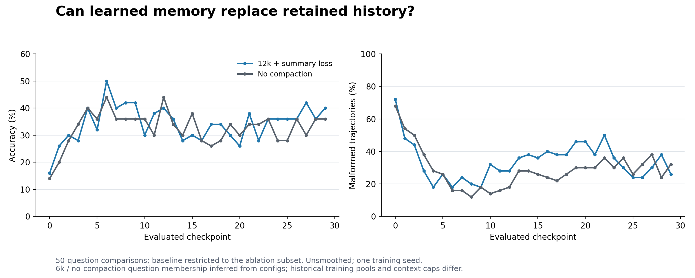
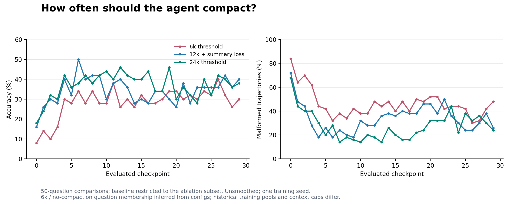
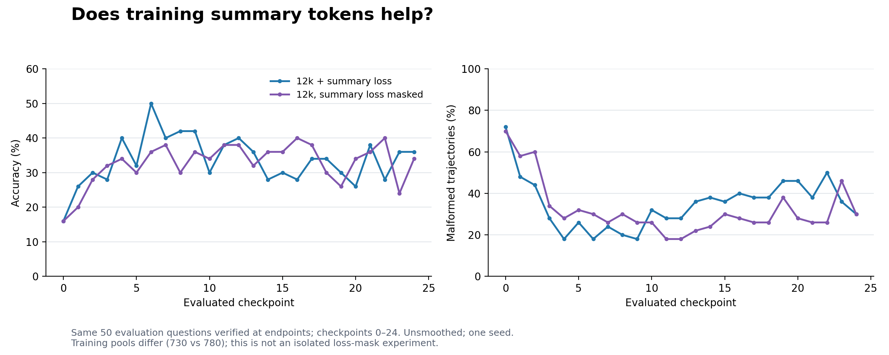
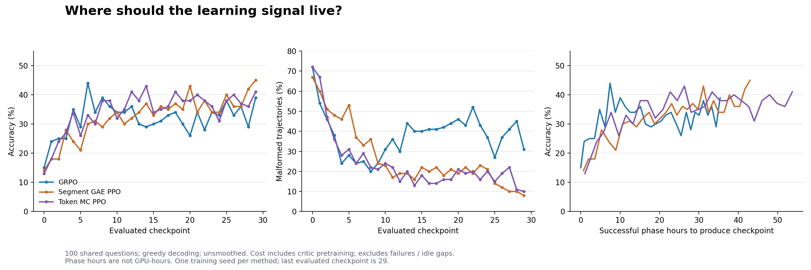

# Learning to carry the right memory: training agents for long-horizon research

*A look at our current Qwen3.5-9B runs on BrowseComp-Plus. Data snapshot: November 17, 2026.*

A research agent can find a useful clue early, spend several more searches resolving ambiguity, and then need that original clue to answer correctly. As the investigation grows, keeping every observation in the active context becomes expensive. Summarizing creates room to continue, but introduces a new failure mode: the agent can discard precisely the evidence it will need later.

This makes compaction a learning problem. The agent must learn both how to investigate and what to carry forward. A useful summary preserves evidence, eliminated hypotheses, unresolved questions, and the next promising action. Its quality ultimately depends on whether the continued investigation succeeds.

Our current experiments probe three parts of that problem: whether compaction helps relative to retaining history, how often to compact and whether to train the summary tokens, and how to assign credit across the resulting trajectory. The results suggest a practical role for learned memory, but do not establish a universal winning threshold or training algorithm. The clearest improvement in these runs is that learned critics produce fewer malformed trajectories than GRPO.

## The task and the memory boundary

The agent answers BrowseComp-Plus questions using a retrieval index through `search` and `get_document`. The policy is Qwen3.5-9B. Training collects four stochastic rollouts per question, with 50 questions per update; saved policy evaluations use one greedy rollout per question. Correct terminal answers receive +1 and unsuccessful outcomes receive −1 under the signed binary reward setup. The episode budget is 36,000 tokens, counting model completions **and raw tool-result content**. It is not a 36,000-token allowance for reasoning alone.

A runtime threshold triggers compaction after a completed tool round. The runtime appends a summary request, disables tools for that generation, and records the raw summary completion. A successful summary closes the old interval. The next interval begins with the unchanged system instructions, unchanged original question, and the extracted summary wrapped as compressed history. There is no retained raw-event tail beside it. Invalid summaries terminate the rollout rather than becoming memory.

Within each interval, the trajectory is strictly append-only. Sampled tokens remain the authoritative training evidence; parsing cannot repair or reconstruct earlier history. This matters because learning from a cleaned-up continuation would teach the policy on a history it did not actually generate.

By default, the policy loss covers all sampled assistant tokens: reasoning, actions, summaries, and final answers. Tool observations and runtime controls provide conditioning. Summary learning therefore comes from eventual task success, without a separate reference summary or human summary-quality score.

## Does self-summarization help compared with keeping the history?

The first comparison is `qwen-bcplus-train`, which compacts around 12,000 active-context tokens, against `qwen-bcplus-no-compact-32k-train`, which disables compaction. The latter is the saved run corresponding to the requested “qwen-bcplus-no-compact-32k” baseline.

Evaluation membership matters here. The baseline has 100 evaluation questions, while the ablations have 50. For the comparisons below, we reconstruct the baseline's accuracy and malformed rate on the ablation's 50-question subset from previously audited per-question outcomes. For the no-compaction and 6k runs, raw per-question files are unavailable locally; their membership is inferred from the matching current partition configurations. This is stronger than comparing the original aggregate scores, but still requires that explicit qualification.

*Figure 1. Saved checkpoint evaluations, without smoothing. The compaction baseline uses the 50-question subset. Failures remain in the accuracy denominator.*

| On the 50-question comparison set | 12k compaction | No compaction |
|---|---:|---:|
| Initial accuracy | 16% | 14% |
| Latest accuracy, checkpoint 29 | 40% | 36% |
| Mean accuracy, checkpoints 20–29 | 35.4% | 32.8% |
| Latest malformed rate | 26% | 32% |

Compaction remains competitive with retaining history: the late-window accuracy difference is 2.6 percentage points, and the final difference is two questions. These are modest differences in small, single-seed evaluations. They support continued investigation of compacted memory, rather than a decisive claim that compaction improves accuracy.

There is also a real configuration difference beyond memory replacement. Despite its historical “32k” name, the no-compaction preset currently allows a 40,960-token runtime context and a 49,152-token rollout/training sequence cap; the 12k baseline uses 28,000 and 27,000 respectively. Their training partitions also differ, at 780 versus 730 questions. These runs compare working configurations, not an isolated switch under identical resources.

The baseline's original full-100-question result is 39% at checkpoint 29. The 40% above is its score on the smaller subset; the two numbers should not be interchanged.

## How often should the agent compact?

Compaction frequency trades retained context against repeated compression. A low threshold gives the agent more memory boundaries to cross. A high threshold lets more raw evidence remain available before a summary must carry it.

*Figure 2. Threshold comparisons using 50-question accuracy and malformed rates. The 12k series is restricted to the ablation subset. Thresholds are triggers checked after tool rounds, not hard maximum prompt lengths.*

| Threshold | Latest accuracy, checkpoint 29 | Mean accuracy, checkpoints 20–29 | Latest malformed rate |
|---|---:|---:|---:|
| 6k | 30% | 32.0% | 48% |
| 12k | 40% | 35.4% | 26% |
| 24k | 38% | 35.4% | 24% |

The 24k configuration has the strongest mean accuracy over checkpoints 1–24: 37.5%, compared with 34.25% for 12k and 28.42% for 6k. Later, the 12k and 24k curves average to the same 35.4%. The data favor avoiding aggressive 6k compaction in this setup; they do not identify a clear winner between 12k and 24k.

The logged behavior helps explain what changes. At checkpoint 29, the 6k run averages 4.24 summaries per question, versus 0.66 for 24k. Summary generations consume about 1,501 versus 239 tokens per question, including their reasoning and output. More frequent compaction creates more opportunities for a lossy handoff or a format failure. That is a plausible explanation for the 6k run's weaker performance, not a measured diagnosis of evidence loss.

This sweep also changes capacity: current runtime context limits are 24k, 28k, and 40,960 for the 6k, 12k, and 24k presets, with rollout/training sequence caps of 32,768, 27,000, and 49,152. A controlled threshold study would hold those limits fixed and measure what information survives each handoff.

## Does the summary need its own policy-loss contribution?

The `qwen-bcplus-no-compaction-loss` run still generates summaries and continues from them. Its ablation masks the generated compaction tokens from the policy loss. Research and answer tokens continue to learn, and the shared model can still change its summarization behavior indirectly. “No compaction loss” therefore means removing direct optimization of summary-generation tokens, not freezing a separate summarizer.

*Figure 3. Both series end at checkpoint 24, the latest saved evaluation for the loss ablation at snapshot time. The baseline is evaluated on the same 50-question subset, verified against ablation endpoints.*

| Matched checkpoints and questions | Train summary tokens | Mask summary tokens |
|---|---:|---:|
| Mean accuracy, checkpoints 1–24 | 34.25% | 33.33% |
| Mean accuracy, checkpoints 20–24 | 32.8% | 33.6% |
| Accuracy at checkpoint 24 | 36% | 34% |
| Malformed rate at checkpoint 24 | 30% | 30% |

There is no clear accuracy advantage for direct summary-token training in this snapshot. The full-window difference is less than one percentage point; the short late window slightly favors masking. The final difference is one question.

This does not establish that summary training is unnecessary. The runs use different training pools, and the masked run has fewer saved evaluations. A clean follow-up would match the training partition and initialization, then evaluate continuation success after one and multiple summaries. Task accuracy alone cannot tell us whether summaries preserve the right evidence.

## Assigning credit across a compacted trajectory

Compaction creates natural state boundaries: each interval starts from either the original task or a compressed history. We compare three ways to turn terminal reward into a learning signal.

**GRPO** compares four complete rollouts for the same question. A rollout's group-normalized advantage is applied across its intervals and assistant tokens. Normalization counts each rollout once, so an agent does not gain extra reward-normalization weight by compacting more often. This provides an inexpensive baseline, but gives no within-rollout distinction between useful and harmful decisions.

**Segment GAE PPO** uses a separate Qwen3.5-0.8B critic to value the first-generation prompt boundary of each interval. With gamma 1 and lambda 0.95, temporal-difference errors propagate through successor intervals; the resulting interval advantage is shared by its sampled tokens, including its summary. This makes the post-compaction state relevant to credit assignment while keeping critic inputs short.

**Token MC PPO** uses a separate 0.8B critic to predict the eventual return from the causal prefix before each sampled token. Its advantage is `R − V_old(prefix)`, frozen before fitting the current batch. This offers finer variation in update magnitude, at substantially greater critic cost.

A token-dependent baseline is not dense process supervision. Here, rewards and values lie in [−1, +1], so successful-rollout advantages are nonnegative and unsuccessful-rollout advantages are nonpositive. The token critic can scale the contribution of different prefixes, but cannot independently reward a good action inside a failed rollout through this estimator.

*Figure 4. All three methods use the same 100 saved evaluation questions. Cost includes successful logged phases and critic pretraining, excludes failed attempts and idle gaps, and is not normalized GPU-hours.*

| Measurement | GRPO | Segment GAE PPO | Token MC PPO |
|---|---:|---:|---:|
| Mean accuracy, checkpoints 1–10 | **32.5%** | 26.5% | 30.0% |
| Mean accuracy, checkpoints 1–29 | 32.48% | 32.97% | **35.03%** |
| Mean accuracy, checkpoints 20–29 | 33.0% | **38.2%** | 37.5% |
| Latest accuracy, checkpoint 29 | 39% | **45%** | 41% |
| Best observed accuracy | 44% | **45%** | 43% |
| Latest malformed rate | 31% | **8%** | 10% |
| Successful logged phase hours, 30 updates | **36.28** | 44.15 | 55.38 |

GRPO improves fastest early and has the lowest recorded pipeline cost. Token MC has the highest average accuracy across the post-initial learning curve. Segment GAE has the strongest late-window and final accuracy, and costs less than token MC. Its online critic subprocess averages roughly 95 seconds per update versus 1,099 seconds for token MC.

The most pronounced separation is reliability. Late-window malformed rates average 40.2% for GRPO, 15.8% for segment GAE, and 17.3% for token MC. All of these failures count against accuracy. Some of the critic methods' advantage may therefore come from learning to survive the protocol, rather than better research or evidence retention alone.

The accuracy ranking remains uncertain. The existing paired question bootstrap gives a checkpoint-29 segment-minus-GRPO difference of +6 points with a 95% interval of −3 to +15. Token-minus-GRPO is +2 points [−6, +10]. These intervals condition on one trained run per method; they do not capture variation across training seeds. Best observed checkpoints are also much closer than a final-checkpoint ranking suggests.

Both critics received pretraining on 200 additional rollouts and still collect four rollouts per policy-training question. The comparison changes return estimation and critic-head representation as well as granularity: segment uses GAE with a 51-bin head; token uses Monte Carlo returns with a two-class head. Different batching, offload settings, and actor optimizer-step counts further limit causal cost comparisons. These are useful implementations to compare, but they do not isolate segment versus token granularity.

## What we take forward

The current runs show that an agent can learn to investigate while repeatedly replacing its active history with its own summary. Compaction is competitive with retained history under the available episode budget. Compressing at 6k appears too aggressive for this setup; 12k and 24k remain viable choices. Directly training summary tokens has not yet produced a clear gain in the available ablation.

For credit assignment, segment GAE is an attractive next candidate: it combines the strongest late-stage accuracy with low malformed rates and less recorded cost than token MC. GRPO remains an essential baseline because it is cheaper and learns quickly early. Token MC remains useful because its average learning-curve accuracy is strongest.

The next experiments should separate memory quality from protocol survival: match partitions, capacities, and training budgets; repeat seeds; compare segment MC with segment GAE; and measure downstream success after alternative summaries of the same frozen history. The question is whether the memory preserves what the agent needs to finish the investigation. Our current curves begin to answer that question, but do not yet resolve it.

---

**Data and reproduction.** Figures use saved local evaluation logs; no models were retrained or re-evaluated. Most runs completed 30 updates but have policy evaluations only through checkpoint 29. The summary-loss ablation has evaluations through checkpoint 24. Windows are retrospective, and repeated evaluations are not independent test sets. The 50-question ablations use current 780-question training partitions versus 730 for the main comparison; verifying their evaluation overlap does not make their training pools identical. Current YAML files are configuration evidence, not immutable launch manifests. Older high-scoring value-MC runs are outside this comparison because they are not established as matched experiments under the same collection/reward semantics.

The [asset manifest](learning-to-compact-assets/sources.json) records snapshot time, source hashes, checked question IDs, and limitations. [Numerical summaries](learning-to-compact-assets/summary.json) accompany PNG, SVG, and PDF versions of each figure. The [earlier critic audit](../analysis/2026-11-06-token-segment-grpo.md) supplies the paired statistics and detailed estimator checks; this post does not repeat a full token-integrity or judge-semantics audit.

From the repository root, run `.venv/bin/python scripts/build_compaction_blog.py --plots-only` to reproduce figures from the frozen snapshots. Omitting `--plots-only` refreshes the assets from current runs and checks their compatibility with the existing critic audit. The script writes only derived blog assets.
